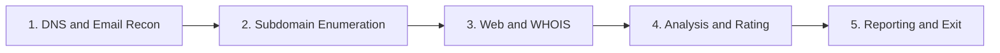

# Domain-Footprinting-Tool

`git clone https://github.com/Wan768/Domain-Footprinting-Tool.git`


`cd Domain-Footprinting-Tool`


`pip install -r requirements.txt`


to run the code: `python main.py example.com`

## Description

For one target domain, FootPrinter runs six checks in sequence and rates each findings as High, Medium, Low or Info. The results are shown in the terminal and saved as a JSON report on the local machine.

| Check | What it does |
| --- | --- |
| DNS records | Retrieves A, AAAA, MX, NS and TXT records, with a fallback to public resolvers |
| SPF analysis | Flags a missing SPF record, multiple records and weak qualifiers (`+all`, `?all`, `~all`) |
| DMARC analysis | Flags a missing DMARC record, `p=none`, `p=quarantine` and a missing `rua` address |
| Subdomain enumeration | Uses Certificate Transparency logs (crt.sh) and a 20-word wordlist, with wildcard DNS detection |
| HTTP security headers | Flags missing HSTS, CSP, X-Frame-Options and X-Content-Type-Options, and version disclosure |
| WHOIS | Retrieves registrar, dates and name servers, and flags expired or soon-to-expire domains |

## Attack Category
| Item | Detail |
|---|---|
| Category | Offensive OSINT (Category 6) |
| Lifecycle stage | Reconnaissance, with part of enumeration |
| Language | Python 3 |
| Libraries | `dnspython`, `python-whois`, `requests` |
| License | MIT |

## Attack Lifecycle Mapping

Footprinter covers the **reconnaissance** stage of an engagement and part of enumeration. 
Before step 1, the shows the legal disclaimer, asks for authorization and validates the domain name.


| Step | Functions | What happens |
|---|---|---|
| 1. DNS and Email Recon (passive) | `get_dns_records()`, `check_spf()`, `check_dmarc()` | Retrieves DNS records and assesses email spoofing protection |
| 2. Subdomain Enumeration (passive and active) | `fetch_crtsh()`, `brute_force()`, `has_wildcard()` | Finds subdomains from certificate logs and a 20-word list, and skips the list if wildcard DNS would cause false results |
| 3. Web and WHOIS (active and passive) | `check_http_headers()`, `check_whois()` | Checks security headers and version disclosure, then retrieves registration and expiry data |
| 4. Analysis and Rating | `finding()`, `run_analysis()` | Rates each finding High, Medium, Low or Info and counts them |
| 5. Reporting and Exit | `print_readable_summary()`, `save_output()` | Shows the summary in the terminal and saves a JSON report locally. `Ctrl+C` stops the scan at any time. |

**Not covered (by design):** port scanning, credential testing, exploitation, persistence and covering tracks. The tool reports configuration weaknesses only. Any later stage would need separate written authorization.

## Installation

**Requirements:** Python 3.9 or newer, and `git`.

```bash
git clone https://github.com/Wan768/Domain-Footprinting-Tool.git
cd Domain-Footprinting-Tool
pip install -r requirements.txt
```

Optional: use a virtual environment so the libraries stay separate from your system Python.

```bash
python -m venv venv
source venv/bin/activate        # Windows: venv\Scripts\activate
pip install -r requirements.txt
```

Dependencies (declared in `requirements.txt`): `dnspython`, `python-whois`, `requests`.


## Usage

Run the tool from the project folder.

```bash
python main.py [domain] [--delay SECONDS] [--dry-run]
```

| Option | Purpose | Default |
|---|---|---|
| `domain` | Target domain | `example.com` |
| `--delay` | Seconds to wait between network steps and between subdomain guesses | `1.0` |
| `--dry-run` | Show the planned steps without sending any request | Off |
| `-h`, `--help` | Show the help text and usage examples | |

### Examples

```bash
# Scan the safe default target
python main.py

# Scan a domain you are authorized to test
python main.py example.com

# Slow the scan down to reduce load on the target
python main.py example.com --delay 2

# Preview every step without sending any request
python main.py example.com --dry-run

# Show help
python main.py --help
```

### What happens when you run it

1. The tool shows the legal disclaimer and asks: `Do you have authorization to scan the target? (y/N)`. Any answer other than `y` ends the program before any request is sent.
2. It runs the five steps in the [lifecycle mapping](#attack-lifecycle-mapping).
3. It prints a summary of the subdomains found, the findings and a severity count.
4. It saves the full report to `Scan_output/<domain>_footprint_<timestamp>.json`.

Press `Ctrl+C` at any time to stop the scan.


### Output

The terminal summary has this layout:

```
[+] Subdomains Discovered (N):
  -> www.example.com (crt.sh)

[+] Security Findings:
  -> [Severity] (CATEGORY) Title: detail

[+] Severity Breakdown: High=0 | Medium=0 | Low=0 | Info=0
```

| Severity | Meaning |
|---|---|
| High | A serious gap, such as no SPF or DMARC record, or an expired domain |
| Medium | A weak setting, such as a missing HSTS or CSP header, or `p=none` in DMARC |
| Low | A minor issue, such as a missing X-Frame-Options header or a version number in the `Server` header |
| Info | A note, such as wildcard DNS detected or a lookup that failed |

The JSON report contains these keys: `domain`, `timestamp`, `records`, `subdomains`, `whois`, `findings` and `summary`.

## Ethical Considerations

This tool is built with defensive guardrails and safe-by-design principles to minimize risk during security assessments:
* **Explicit Authorization Gate:** On startup, the tool displays a legal warning banner and requires explicit user confirmation (`y`) before any network activity begins.
* **Safe Defaults & Dry-Run Mode:** If no target domain is provided, the tool defaults safely to `example.com`. Users can also pass `--dry-run` to preview all planned reconnaissance steps without sending a single network packet.
* **Rate Limiting (`--delay`):** Configurable delays (defaulting to `1.0` second between stages and `0.5` seconds during subdomain checks) prevent request flooding, service disruption, or accidental Denial-of-Service (DoS).
* **Local-Only Data Handling:** All collected reconnaissance data and security findings are stored strictly locally in the `Scan_output/` directory (`<domain-name>_footprint_<timestamp>.json`) with clear labeling, and are excluded from version control via `.gitignore`. No data is transmitted to external third-party servers.
* **Clean Kill Switch:** Pressing `Ctrl+C` (`KeyboardInterrupt`) immediately halts execution and exits cleanly without leaving hanging processes.

---

## Rules of Engagement (RoE)

Any operator using this tool must strictly adhere to the following Rules of Engagement:
* **Authorized Scope:** Testing must only be conducted against domains, subdomains, and infrastructure explicitly owned by the operator or covered under a signed, written authorization agreement.
* **Time Windows:** Active reconnaissance (such as DNS subdomain brute-forcing and HTTP header requests) should be performed during agreed-upon testing windows or off-peak hours to avoid interfering with production traffic.
* **Permitted Techniques:** Passive OSINT queries (public DNS records, WHOIS lookups, and Certificate Transparency logs via `crt.sh`) and low-rate, non-intrusive HTTP `GET` header inspections.
* **Prohibited Actions:** Exploitation of discovered vulnerabilities, brute-forcing credentials, aggressive high-speed flooding (`--delay 0` against unauthorized targets), or modifying target systems.
* **Emergency Stop Procedures:** If anomalous behavior, rate-limit warnings, or service instability occurs, the operator must immediately press `Ctrl+C` to trigger the tool's built-in kill switch and halt all network requests.

---

## Responsible Disclosure

If this tool uncovers security misconfigurations (such as missing SPF/DMARC policies allowing email spoofing, missing HSTS/CSP headers, or exposed staging/admin subdomains) on an authorized target, operators must follow responsible disclosure practices:
* **Who to Report To:** Report findings directly to the target organization's designated security team.
* **When to Report:** Disclose high-severity findings (such as absent SPF/DMARC records or expired domains) promptly upon verification, allowing the organization a reasonable remediation window (typically 30–90 days) before any public discussion.
* **How to Report:** Provide a clear, confidential, and reproducible technical summary containing the affected domain/subdomain, the specific misconfiguration observed, potential security impact, and actionable remediation steps—without including sensitive or exfiltrated data.

---

## Legal Disclaimer

 **WARNING:** This tool is developed strictly for educational purposes, academic research, and authorized security auditing. 

Unauthorized scanning, enumeration, or probing of computer systems and networks without explicit prior written permission from the asset owner is illegal under the **Computer Crimes Act 1997 (Malaysia)** and applicable local and international cybersecurity laws. The authors and contributors assume no liability and are not responsible for any misuse, unauthorized activity, or damage caused by this software. By running this tool, you accept full legal responsibility for ensuring your actions remain within authorized boundaries.

---

## Limitations

* **Small Built-In Subdomain Wordlist:** The active brute-force module uses a compact 20-word list of common subdomains (`www`, `mail`, `dev`, `admin`, etc.) to stay fast and non-intrusive, meaning uncommon or custom subdomain names may not be detected unless discovered via `crt.sh`.
* **Wildcard DNS Suppression:** When a target domain configures wildcard DNS (`*.domain.com`), the tool intentionally skips active brute-force results to avoid false positives, relying solely on passive Certificate Transparency data.
* **Third-Party Rate Limits & Availability:** Passive subdomain discovery depends on the availability and response time of `crt.sh`, while WHOIS lookups may occasionally return incomplete dates or face rate limits depending on the domain registrar's WHOIS server.
* **Passive / Header-Level Analysis Only:** This tool performs non-intrusive reconnaissance and configuration auditing only; it does not perform deep port scanning, service exploitation, or authenticated web vulnerability testing.
